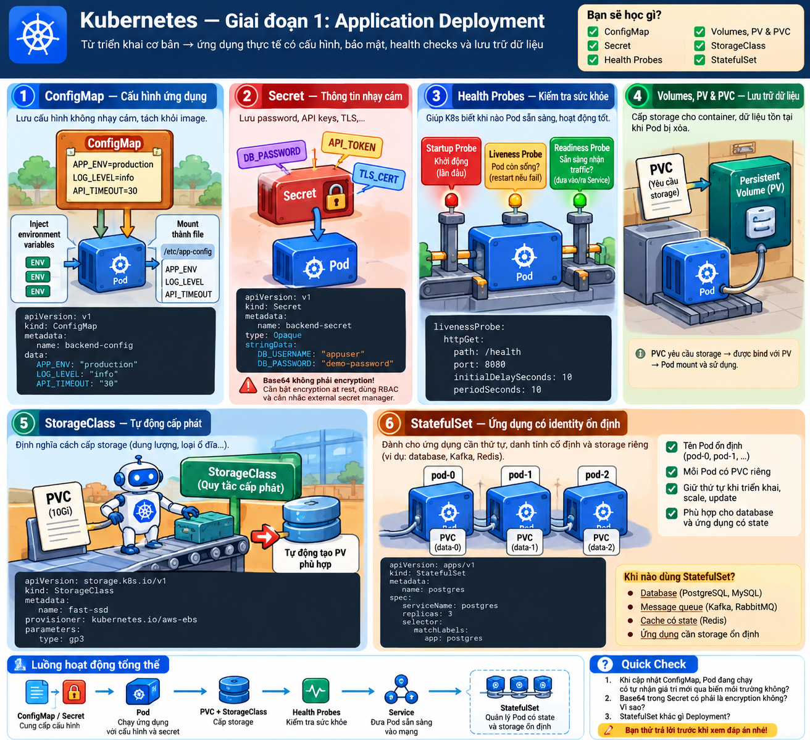
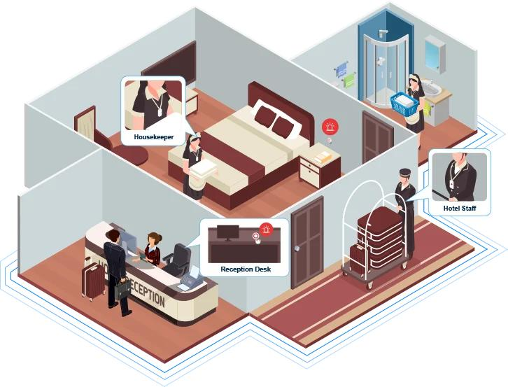
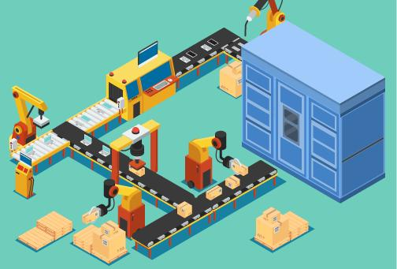
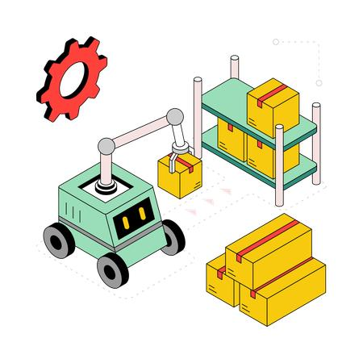
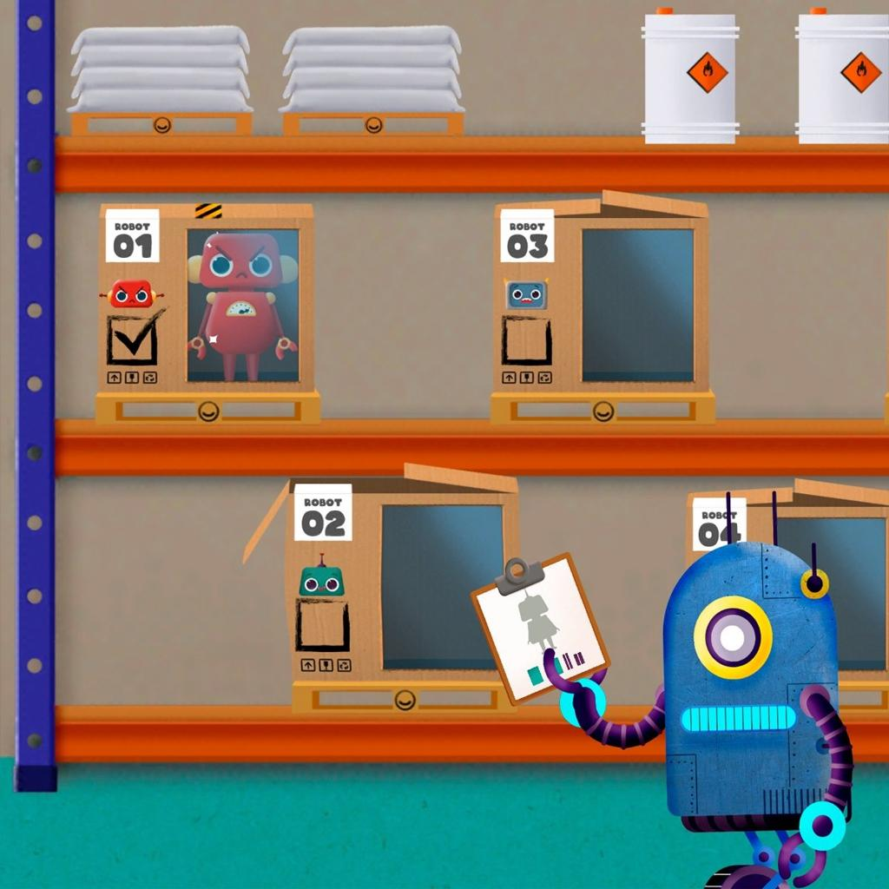
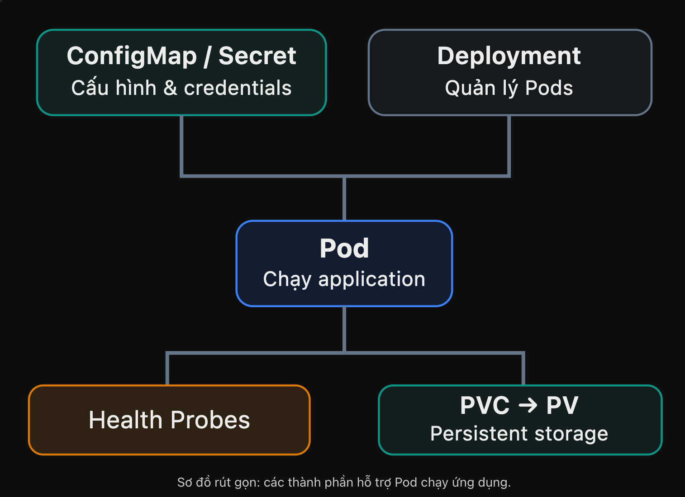

# Visual Mnemonic — Giai đoạn 1: Application Deployment

> Intermediate · 6 chủ đề · Mnemonic + Visual Learning

## 1. Big Picture — Từ Pod đến ứng dụng thực tế

Pod và Deployment giúp chạy ứng dụng, nhưng ứng dụng thực tế còn cần **configuration, credentials, health checks, persistent storage và stable identity**. Hãy tưởng tượng một **khách sạn Kubernetes** với bảng nội quy, két bảo mật, người quản lý sức khỏe và những chiếc tủ lưu trữ.

## 2. Visual Mnemonic — Khách sạn Kubernetes

### ConfigMap — Bảng nội quy

Chứa cấu hình không nhạy cảm như LOG_LEVEL, APP_ENV.

### Secret — Két bảo mật

Chứa password, API tokens, certificates. Base64 không phải encryption.

### Health Probes — Quản lý nhân viên

Startup: Chuẩn bị xong chưa? Readiness: Nhận khách được chưa? Liveness: Còn hoạt động không?

### PVC / PV — Phiếu xin tủ / Tủ thật

PVC yêu cầu dung lượng; PV đại diện cho storage được cấp.

### StorageClass — Máy cấp tủ

Xác định cách cấp storage tự động thông qua provisioner.

### StatefulSet — Nhân viên có mã riêng

Mỗi Pod có identity ổn định và có thể có PVC riêng.

## 3. How It Works

Điểm quan trọng: StorageClass tham gia vào quá trình cấp phát PV, còn StatefulSet là một controller khác Deployment, phù hợp khi Pod cần danh tính ổn định.

## 4. Remember This — Những điểm phải nhớ

| Khái niệm | Điều quan trọng |
|---|---|
| ConfigMap | Giá trị inject qua environment variable không tự đổi khi ConfigMap được cập nhật |
| Secret | Base64 ≠ encryption; cần RBAC, encryption at rest và quản lý secret phù hợp |
| Readiness | Fail → Pod Not Ready; không restart container chỉ vì readiness failure |
| Liveness | Fail quá ngưỡng → container restart |
| `emptyDir` | Container restart trong cùng Pod vẫn có thể giữ dữ liệu; Pod bị xóa thì mất |
| PVC | Persistent storage ≠ backup |
| StatefulSet | Stable identity ≠ database replication/HA |

## 5. Mini Quiz — Active Recall

1. Database mất kết nối, backend vẫn sống nhưng không phục vụ được request. Probe nào nên fail?
2. PVC và PV khác nhau thế nào?
3. StatefulSet với ba PostgreSQL replicas đã tự cung cấp HA chưa?

Xem đáp án

1. **Readiness:** Pod có thể bị loại khỏi nhóm backend sẵn sàng mà không restart vô ích.
2. **PVC** là yêu cầu storage; **PV** biểu diễn tài nguyên storage.
3. **Chưa:** replication, failover và backup cần cơ chế khác.

