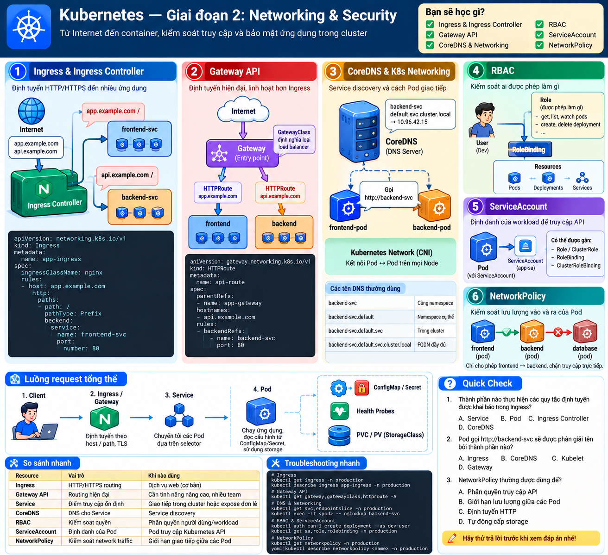
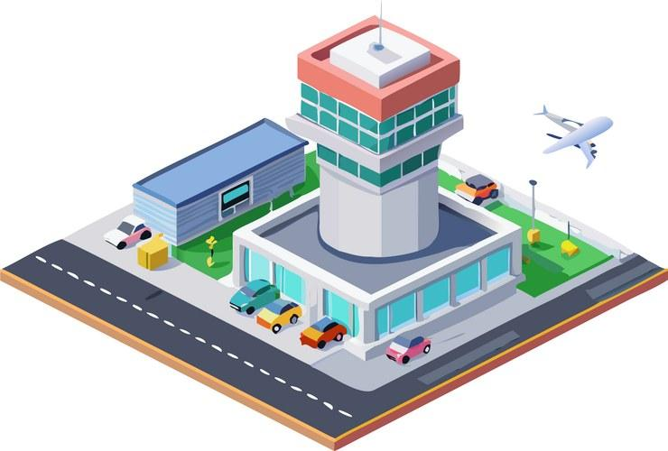
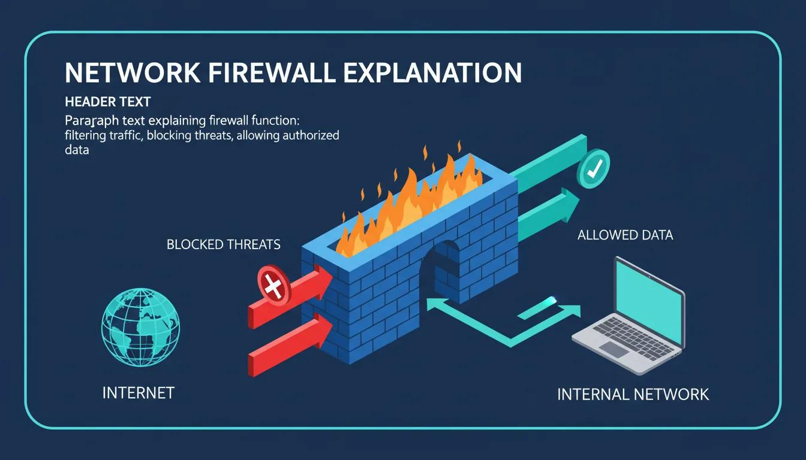
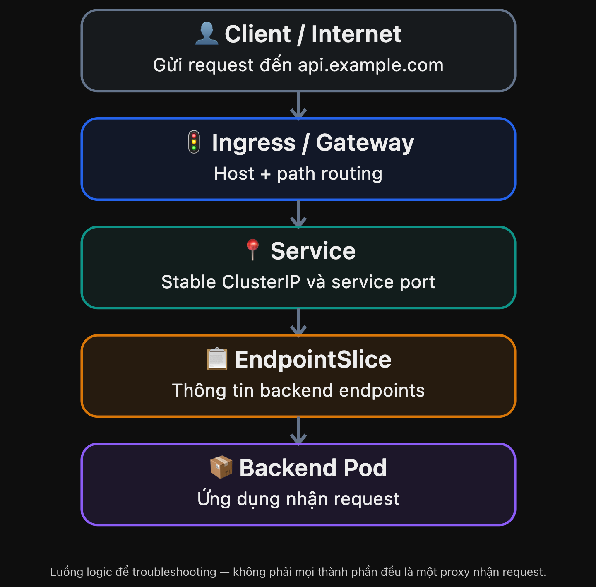

# Visual Mnemonic — Giai đoạn 2: Networking & Security

> Intermediate → Advanced · 6 chủ đề · Visual Mnemonic + Troubleshooting

## 1. Big Picture — Thành phố Kubernetes

Khi ứng dụng đã chạy, cần trả lời: **Request từ Internet tìm đến đúng Pod như thế nào?** và **ai được phép thao tác hoặc kết nối tới tài nguyên nào?** Hãy hình dung Kubernetes như một thành phố với cổng điều hướng, danh bạ, thẻ nhân viên và chốt an ninh.

## 2. Visual Mnemonic

### Ingress — Cổng điều hướng

Nhìn hostname hoặc URL path để đưa HTTP/HTTPS request tới đúng Service. Cần Ingress Controller để thực thi.

### Gateway API — Trung tâm điều phối

GatewayClass chọn cách triển khai, Gateway mở cổng tiếp nhận, HTTPRoute chỉ định đường đi.

### CoreDNS — Danh bạ thành phố

Chuyển tên Service như backend-svc thành địa chỉ mạng để ứng dụng tìm nhau.

### RBAC — Bảng phân quyền

Quyết định danh tính nào có quyền get, list, create, delete tài nguyên Kubernetes.

### ServiceAccount — Thẻ nhân viên

Cung cấp danh tính cho workload khi cần xác thực với Kubernetes API.

### NetworkPolicy — Chốt kiểm soát đường đi

Quy định những kết nối ingress và egress nào của Pod được phép.

## 3. How It Works — Request flow

Hai điểm cực kỳ dễ nhầm:
CoreDNS giúp phân giải tên Service trước khi kết nối; nó không chuyển tiếp từng HTTP request. EndpointSlice cung cấp thông tin backend cho Service dataplane, chứ không phải một proxy mà packet phải đi qua.
Service routing thường do kube-proxy hoặc dataplane tương đương thực hiện. CNI cung cấp nền tảng kết nối mạng cho các Pod.

## 4. Security — Ba câu hỏi khác nhau

| Công cụ | Câu hỏi |
|---|---|
| ServiceAccount | Tôi là ai? |
| RBAC | Tôi có quyền làm gì trên Kubernetes API? |
| NetworkPolicy | Pod của tôi được kết nối với Pod nào? |

Ví dụ: Backend Pod cần đọc Pods trong namespace và kết nối PostgreSQL. ServiceAccount cung cấp danh tính; Role + RoleBinding cấp quyền Kubernetes API; NetworkPolicy giới hạn traffic vào/ra Backend. AWS S3 access vẫn cần **AWS IAM** (ví dụ EKS Pod Identity hoặc IRSA), không được tự cấp bởi RBAC.

## 5. Remember This

- **Ingress ≠ Controller:** khai báo quy tắc khác thực thi quy tắc.
- **CoreDNS ≠ Dataplane:** DNS tìm địa chỉ, dataplane chuyển kết nối.
- **RBAC ≠ NetworkPolicy:** API authorization khác network segmentation.
- **Default Deny Egress** có thể chặn cả DNS; cần mở kết nối đúng mục đích.
- NetworkPolicy cần **CNI hỗ trợ enforcement**.
- Lỗi `502` phải trace theo Ingress/Gateway → Service → backend endpoints → Pod → ứng dụng, không chỉ nhìn Pod `Running`.

## 6. Mini Quiz

1. Ingress YAML đã apply nhưng không có Ingress Controller: chuyện gì có thể xảy ra?
2. CoreDNS chịu trách nhiệm gì?
3. Backend cần đọc Pods trong một namespace: resource nào cấp quyền?
4. Muốn chặn Frontend kết nối trực tiếp database: dùng gì?

Xem đáp án

1. Routing thường không hoạt động vì thiếu controller phù hợp.
2. Phân giải tên Service.
3. `Role` + `RoleBinding` (gán cho danh tính phù hợp).
4. `NetworkPolicy`, nếu network plugin hỗ trợ thực thi chính sách.

