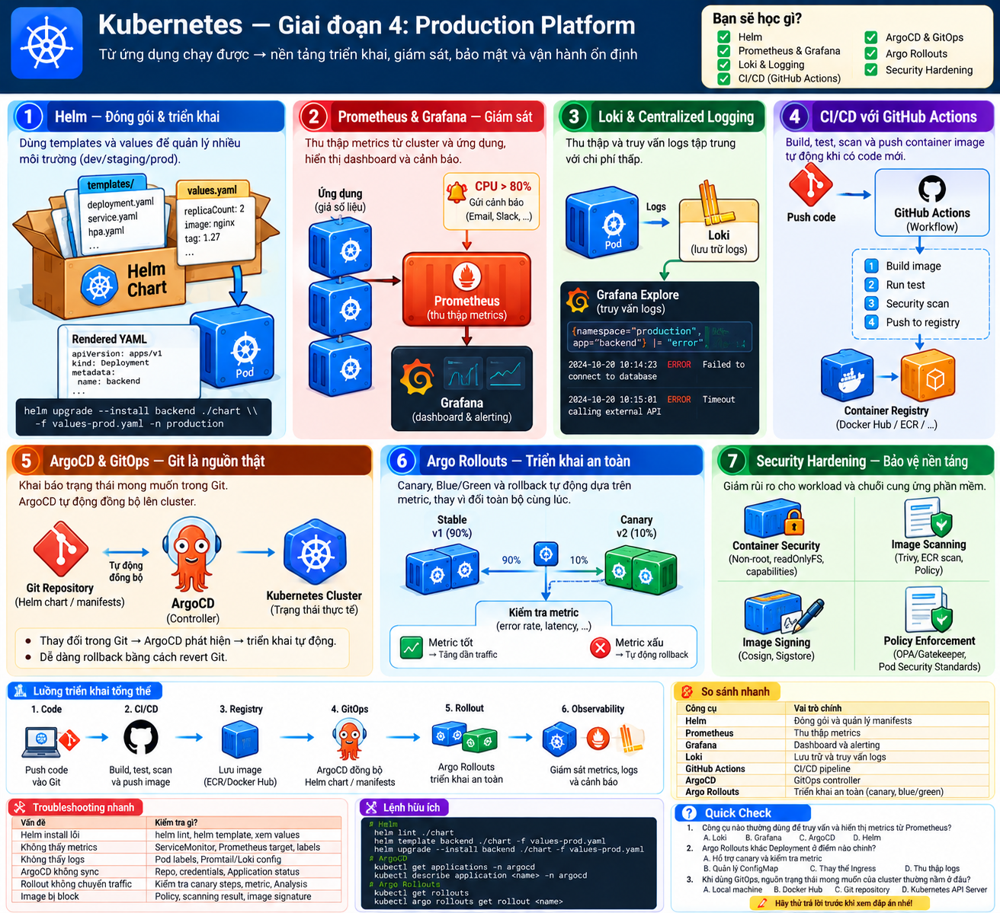
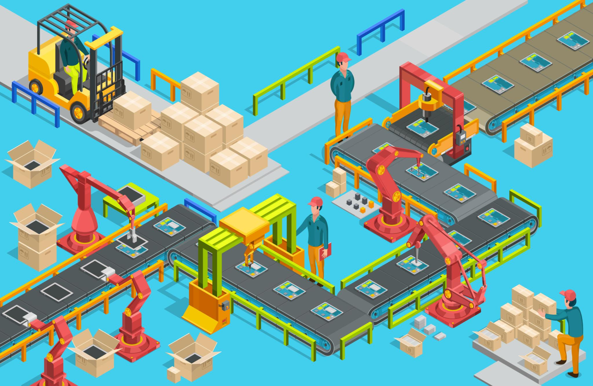
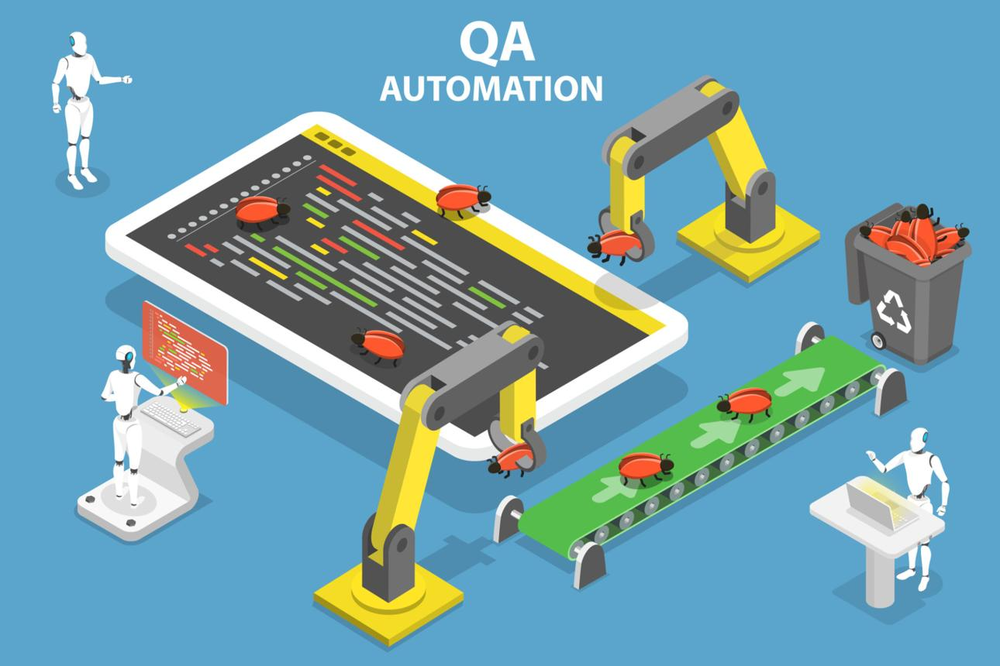
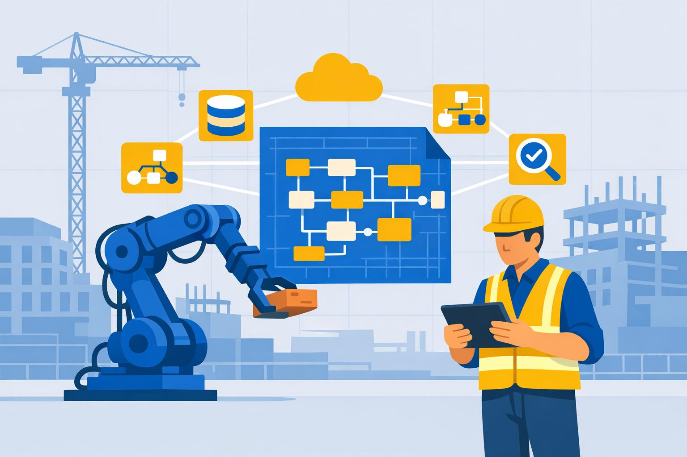
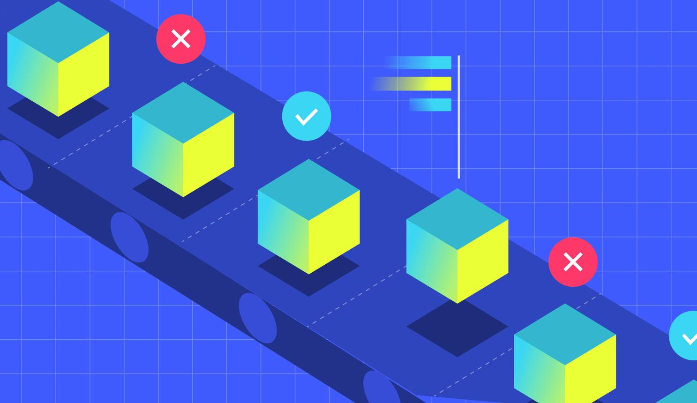
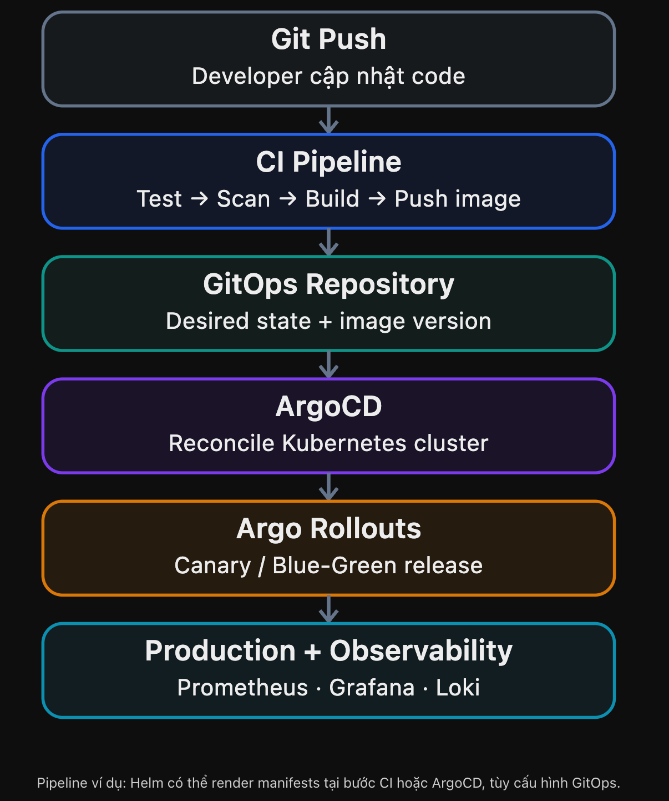

# Visual Mnemonic — Giai đoạn 4: Production Platform

> Advanced · Helm · Observability · CI/CD · GitOps · Security

## 1. Big Picture — Nhà máy vận hành phần mềm

Không chỉ chạy Pod: bạn cần **build, deploy, monitor, release an toàn và recover**. Hãy tưởng tượng Kubernetes là một nhà máy phần mềm tự động với dây chuyền kiểm định, thiết bị giám sát và quản lý bản thiết kế.

## 2. Visual Mnemonic

### Helm — Máy đóng gói

Đóng gói templates và values thành manifests, quản lý cài đặt, nâng cấp và rollback theo release.

### Prometheus & Grafana — Phòng giám sát

Prometheus thu thập metrics; Grafana hiển thị dashboard giúp phát hiện bất thường.

### Loki — Kho nhật ký

Tập trung logs từ các Pod để tìm lỗi, tra cứu sự kiện và điều tra incident.

### CI/CD — Dây chuyền kiểm định

Tự động test, scan, build và phát hành container images.

### ArgoCD — Giám sát bản thiết kế

So sánh trạng thái thực tế với Git, đồng bộ và có thể tự sửa configuration drift.

### Argo Rollouts — Thử hàng trước khi giao

Phát hành Canary hoặc Blue/Green, kiểm soát rủi ro khi đưa phiên bản mới vào sử dụng.

## 3. How It Works — Code đến Production

Một điểm quan trọng: ArgoCD không thay thế Argo Rollouts. ArgoCD chịu trách nhiệm đồng bộ desired state, còn Argo Rollouts quản lý chiến lược phát hành phiên bản mới.

## 4. Remember This

| Công nghệ | Một câu ghi nhớ |
|---|---|
| Helm | Render và quản lý release, không liên tục tự reconcile cluster như GitOps controller |
| Prometheus | Metrics: điều gì đang xảy ra và xu hướng ra sao |
| Grafana | Quan sát trực quan với dashboard |
| Loki | Logs: chi tiết sự kiện để điều tra |
| CI/CD | Tự động kiểm tra, xây dựng và phát hành |
| ArgoCD | Git là desired state; `Synced` không đồng nghĩa `Healthy` |
| Argo Rollouts | Phát hành dần hoặc chuyển phiên bản có kiểm soát |
| Security | Không chạy với đặc quyền cao nếu không cần; kiểm tra image và quyền |

**Ba hiểu nhầm quan trọng:**

- **Synced ≠ Healthy**: YAML khớp Git nhưng app có thể vẫn trả 502.
- **Metrics ≠ Logs**: metrics cho biết dấu hiệu; logs giúp lần theo sự kiện chi tiết.
- **Canary ≠ tự động rollback**: cần cấu hình analysis, tiêu chí đánh giá và hành vi abort/rollback phù hợp.

## 5. Production Scenario — API trả 502

CI build thành công, registry có image, ArgoCD hiện `Synced`, nhưng khách hàng thấy HTTP 502. Hãy lần lượt kiểm tra:

1. **Delivery:** commit và image digest có đúng không?
2. **Kubernetes:** Pod có Ready? Có `OOMKilled`, restarts hoặc startup errors không?
3. **Networking:** Service có ready endpoints? Ingress có kết nối được upstream?
4. **Observability:** Metrics tăng 5xx/latency lúc nào? Logs báo timeout, connection refused hay lỗi ứng dụng?
5. **Recovery:** Có thể rollback theo quy trình phát hành không? Sau rollback đã verify request path chưa?

**Nguyên tắc:** Không kết luận chỉ từ trạng thái của một tool; phải trace xuyên suốt deployment và request path.

## 6. Mini Quiz

1. Helm và ArgoCD khác nhau thế nào?
2. ArgoCD `Synced` nhưng API 502 có thể xảy ra không?
3. Prometheus thường dùng hàm nào để tính request rate từ Counter?
4. Canary deployment nhằm mục đích gì?

Xem đáp án

1. Helm quản lý templates/releases; ArgoCD reconcile desired state từ Git.
2. **Có**, vì đồng bộ manifests không chứng minh ứng dụng khỏe.
3. `rate()`.
4. Đưa phiên bản mới đến một phần traffic hoặc replicas trước khi tăng dần để hạn chế blast radius.

## 7. Hands-on gợi ý

Trên `kind-lab`, tạo Helm Chart, chạy `helm lint`, `helm template`, cài release, nâng replica count rồi rollback. Thử `kubectl scale` để tạo configuration drift; lưu ý **Helm không tự sửa drift liên tục** như ArgoCD. Không tự cài cả Prometheus/Loki/ArgoCD vào lab khi chưa đánh giá tài nguyên và prerequisites.
