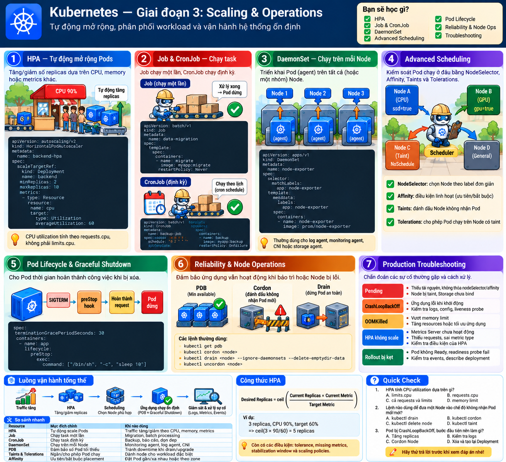
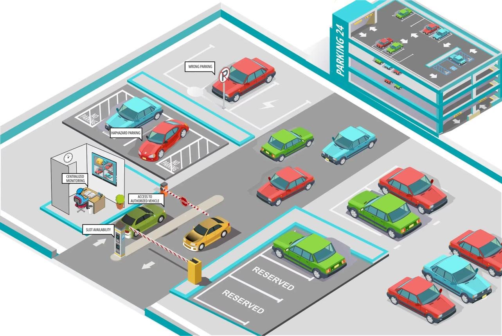
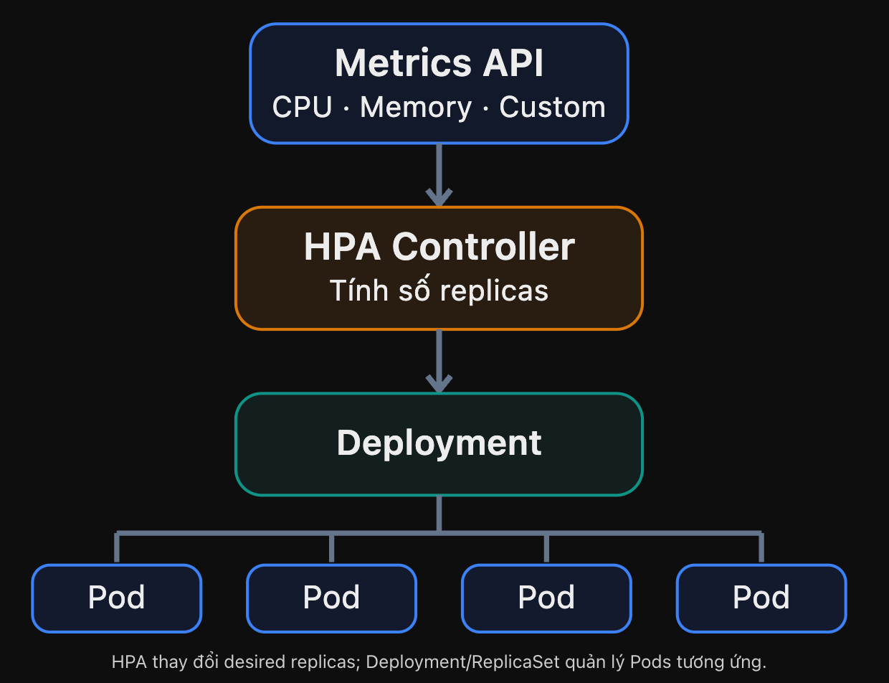
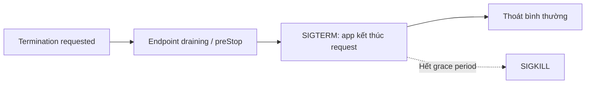

# Visual Mnemonic — Giai đoạn 3: Scaling & Operations

> Intermediate → Advanced · 7 chủ đề · Scaling · Reliability · Troubleshooting

## 1. Big Picture — Thành phố tự vận hành

Traffic tăng thì ai tăng Pod? Pod `Pending` dù Node còn tài nguyên do đâu? Khi bảo trì Node, làm sao giảm gián đoạn? Hãy hình dung một **thành phố giao hàng** có người tăng nhân sự, giao nhiệm vụ, xếp chỗ và bảo trì.

## 2. Visual Mnemonic

### HPA — Quản lý tăng nhân sự

Khi tải theo metrics tăng, HPA tăng số Pod replicas trong giới hạn cho phép.

### Job — Nhiệm vụ một lần

Chạy công việc hữu hạn như data import hoặc migration; có thể retry nếu thất bại.

### CronJob — Lịch giao hàng

Tự tạo Job theo lịch, ví dụ backup mỗi ngày lúc 02:00.

### DaemonSet — Bảo vệ mỗi tòa nhà

Duy trì một agent Pod trên mỗi Node đủ điều kiện, như log collector.

### Scheduler — Người phân chỗ

Chọn Node phù hợp theo tài nguyên, labels, affinity, taints và các ràng buộc khác.

### Graceful Shutdown — Kết thúc ca an toàn

Ngừng nhận công việc mới, hoàn tất request đang xử lý và đóng tài nguyên trước khi thoát.

## 3. How It Works — HPA

Công thức đơn giản:

\[
\text{Desired replicas}=\left\lceil \text{Current replicas}\times\frac{\text{Current metric}}{\text{Target metric}}\right\rceil
\]

Ví dụ: 3 Pods, CPU utilization 90%, target 60% → `ceil(3 × 90/60) = 5 Pods`. CPU utilization cho resource HPA tính theo **CPU requests**, không phải CPU limits. HPA thực tế còn áp dụng tolerance, stabilization, missing metrics và policy; HPA **không tự tăng Node capacity**.

### Tự thử các giá trị

| Replicas | CPU hiện tại | Target CPU | Kết quả công thức |
|---:|---:|---:|---:|
| 3 | 90% | 60% | 5 |
| 2 | 100% | 50% | 4 |
| 6 | 30% | 60% | 3 |

Kết quả trên là phép tính mô phỏng, chưa xét min/max replicas và chính sách thực thi thực tế.

## 4. Advanced Scheduling — Bãi đỗ xe

| Kubernetes | Nhớ bằng hình ảnh |
|---|---|
| `nodeSelector` | Chọn bãi có biển đúng nhãn |
| Required node affinity | Bắt buộc đỗ đúng khu |
| Preferred node affinity | Ưu tiên khu này, có thể chọn khu khác |
| Taint | Biển hạn chế xe vào |
| Toleration | Giấy phép chịu được lệnh hạn chế |
| Pod anti-affinity | Tránh dồn nhiều xe cùng nhóm |

**Chú ý:** Toleration không bắt buộc Pod phải chọn Node có taint, chỉ cho phép nó được xét vào Node đó.

## 5. Graceful Shutdown — Vì sao rollout có thể 502?

**Mnemonic:** “Báo nghỉ → Bàn giao → Hoàn tất → Rời đi”. Routing và quá trình shutdown diễn ra bất đồng bộ; một proxy có thể còn gửi request tới Pod đang dừng trong một khoảng thời gian.

## 6. Remember This

| Thành phần | Điều bắt buộc nhớ |
|---|---|
| HPA | Scale Pods theo metrics, không tự cấp Nodes |
| Job | Tác vụ hữu hạn; chú ý retry/idempotency |
| CronJob | Chạy theo lịch; `Forbid` tránh chồng Jobs |
| DaemonSet | Agent trên mỗi Node đủ điều kiện |
| Scheduler | Constraints có thể làm Pod Pending dù còn CPU/RAM |
| PDB | Giới hạn voluntary disruptions, không ngăn Node đột ngột hỏng |
| Cordon | Ngừng schedule Pods mới |
| Drain | Cố evict các workload Pods phù hợp |

## 7. Mini Quiz

1. 3 replicas, CPU 90%, target 60% → HPA đề xuất mấy replicas theo công thức đơn giản?
2. `concurrencyPolicy: Forbid` trên CronJob là gì?
3. Toleration có ép Pod chạy trên Node có taint không?
4. Node còn tài nguyên nhưng Pod Pending, nên kiểm tra gì?
5. Cordon khác Drain ở đâu?

Xem đáp án

1. **5**.
2. Bỏ lượt Job mới khi Job cũ còn chạy.
3. **Không**.
4. Events, requests, labels/selector, affinity, taints, storage constraints.
5. Cordon chặn scheduling mới; Drain evict Pods đủ điều kiện để chuẩn bị bảo trì.

## 8. Hands-on gợi ý

Trong `kind-lab`, tạo HPA cho workload chịu CPU load, thử Job/CronJob, quan sát DaemonSet, rồi cố tình tạo Pod Pending bằng `nodeSelector` không khớp. Dùng `kubectl describe pod` và Events để lý giải nguyên nhân, không drain production để thử.
